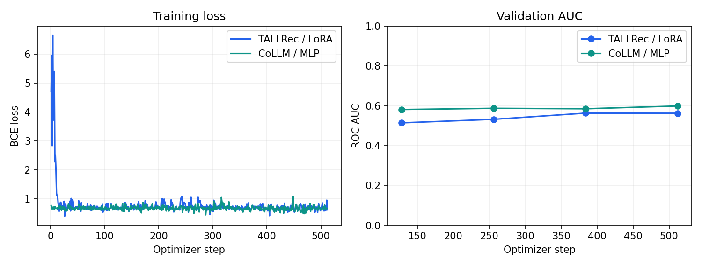

# CoLLM RecSys — Group 6

การทดลอง **CoLLM-MF** บน MovieLens-1M ด้วย **Qwen2-0.5B** เปรียบเทียบกับ
Matrix Factorization (MF) และ TALLRec-style text-only LoRA โดยใช้ **ROC AUC**
เป็นตัวชี้วัดหลัก

อ้างอิง [CoLLM](https://github.com/zyang1580/CoLLM) โดยปรับขนาดโมเดล ข้อมูล
และจำนวน steps ให้เหมาะกับการฝึกบนเครื่อง Windows ที่มี Intel XPU

## วิธีการ

1. **MF:** เรียนรู้ user/item embeddings ขนาด 64 มิติด้วย dot product และ BCE
2. **Stage 1 — TALLRec:** ฝึกเฉพาะ LoRA จากประวัติหนังที่ชอบและชื่อหนังเป้าหมาย
3. **Stage 2 — CoLLM-MF:** ตรึง MF, Qwen และ LoRA แล้วฝึก shared MLP
   ขนาด 64 → 640 → 896 เพื่อแปลง collaborative embeddings เป็น input embeddings ของ LLM
4. **Evaluation:** เลือก checkpoint ด้วย validation AUC แล้วประเมินทั้งสามโมเดล
   บน test records ชุดเดียวกัน

การทำนายใช้ raw **Yes logit** กับ `BCEWithLogitsLoss` ตาม Qwen implementation
ต้นฉบับ Stage 2 ส่ง gradient ผ่าน LLM ที่ตรึงน้ำหนักไว้กลับไปยัง MLP

## ข้อมูล

MovieLens-1M แบ่งตามเวลา กำหนด rating `> 3` เป็น positive

| ชุดข้อมูล | จำนวนทั้งหมดหลังแบ่งเวลา | จำนวนที่ใช้ใน `configs/local.yaml` |
|---|---:|---:|
| Train | 33,891 | 4,096 |
| Validation | 10,401 | 512 |
| Test | 7,331 | 1,024 |

ใช้ positive history สูงสุด 10 เรื่องที่เกิดก่อนเป้าหมายอย่างเคร่งครัด
เหตุการณ์ timestamp เดียวกันไม่เห็นกันใน history ภายใต้ rolling-history protocol
feedback ใน validation/test ที่เกิดก่อนหน้าอาจเป็นประวัติของเหตุการณ์ถัดไป
แต่ไม่ใช้ปรับน้ำหนักโมเดล การสุ่มลด training rows ยังคงประวัติที่สังเกตได้ไว้

Warm หมายถึงทั้งผู้ใช้และหนังมีอย่างน้อย 3 interactions ใน training subset
กลุ่ม cold จึงรวมทั้ง ID ที่ไม่เคยเห็นและ ID ที่มีข้อมูลน้อย

## ติดตั้ง

สภาพแวดล้อมที่ใช้ทดลอง: Windows 11, Python 3.11, PyTorch 2.8.0+xpu,
Intel Arc 140T และ RAM 32 GB

รันจาก root ของ repository ใน PowerShell:

```powershell
python scripts/setup.py --device xpu
.\.venv\Scripts\python.exe -m collm.assets download --config configs/local.yaml
.\.venv\Scripts\python.exe -m collm.data
```

ใช้ `--device cpu` สำหรับติดตั้งบนเครื่อง CPU และตั้ง `device: cpu` ใน config
แพ็กเกจระบุใน `requirements.txt` และ `requirements-lock.txt`
ข้อมูลดิบและโมเดลตรวจ checksum พร้อมบันทึก revision และ content hashes

## ฝึกโมเดล

ดับเบิลคลิก **START_TRAIN.cmd** รอการตรวจความพร้อม แล้วกด **Train**
ระบบทำ MF → Stage 1 → Stage 2 → evaluation และสร้างรายงานตามลำดับ
แต่ละการทดลองมี config, checkpoints และผลลัพธ์แยกโฟลเดอร์
Source ต้องอยู่ใน Git commit ที่ตรงกับ upstream และไม่มีไฟล์ค้างแก้ไข

| ค่าฝึก | `configs/local.yaml` |
|---|---|
| Backbone | Qwen/Qwen2-0.5B, revision ที่ระบุใน config |
| Seed / input length | 42 / 256 tokens |
| LoRA | r=8, alpha=16, dropout=0.05, q_proj/v_proj |
| Batch / accumulation | 4 / 2, effective batch 8 |
| Optimizer steps | 512 ต่อ LLM stage ประมาณหนึ่งรอบของ training subset |
| Learning rate | MF เลือก 1e-3 หรือ 1e-2; LoRA 1e-4; MLP 1e-3 |
| เพดานเวลา | 6 ชั่วโมงต่อ stage/คำสั่ง แยกจากกัน |

ตรวจความพร้อมและทดสอบโค้ด:

```powershell
.\.venv\Scripts\python.exe -m collm.run --check --config configs/local.yaml
.\.venv\Scripts\python.exe -m pytest -q
```

คำสั่ง `--check` ตรวจ assets, prompts, device และ output path โดยไม่ฝึกโมเดล
ใช้ `configs/smoke.yaml` สำหรับตรวจ pipeline ด้วยข้อมูลขนาดเล็ก
รายละเอียดปุ่มหยุด การใช้ checkpoints และการประเมินซ้ำอยู่ใน
[คู่มือการทดลอง](docs/TRAIN_GUIDE_TH.md)

## ผลการทดลองรอบแรก

ทดลองวันที่ 1 พฤศจิกายน 2026 ด้วย config ข้างต้น บน source commit `1306bac`
ทั้งสอง LLM stages ฝึกครบ 512 steps ใช้เวลารวมประมาณ 20 นาที 9 วินาที

| โมเดล | Validation AUC | Test AUC |
|---|---:|---:|
| MF | 0.5194 | 0.5197 |
| TALLRec | 0.5630 | **0.6345** |
| CoLLM-MF | **0.5989** | 0.6311 |

CoLLM-MF สูงกว่า MF แต่ยังไม่เหนือ TALLRec บน test ในรอบนี้
ผลจาก seed เดียวและข้อมูลขนาดเล็กยังไม่เพียงพอสำหรับข้อสรุปทั่วไป
รายละเอียด config, metrics และกราฟอยู่ใน
[ผลรอบแรก](results/run_20261101_020249_9c8eff76/metrics.json)



การทดลองนี้ปรับ backbone, subset, prompt length และ training budget จากเปเปอร์
AUC วัดบน observed held-out ratings ส่วน ranking CSV เป็นตัวอย่างการจัดอันดับ
candidates ภายใต้ประวัติเดียวกัน ไม่ใช่ full-catalog top-k evaluation

## โครงสร้างโค้ด

| ไฟล์ | หน้าที่ |
|---|---|
| `collm/data.py` | Temporal split, history, subsets และ data fingerprints |
| `collm/models.py` | MF, prompts, LoRA, collaborative mapping และ Yes-logit scoring |
| `collm/train.py` | ฝึก MF, LoRA และ mapper |
| `collm/checkpoints.py` | เลือกและตรวจ checkpoint รวมถึง MF/LoRA dependencies |
| `collm/evaluate.py` | AUC, predictions และตัวอย่าง ranking |
| `collm/run.py`, `collm/pipeline.py` | ตรวจความพร้อมและจัดลำดับการทดลอง |
| `collm/launcher.py` | หน้าต่างฝึกและแสดง log |
| `collm/delivery.py` | รายงานและกราฟผลการทดลอง |

Checkpoints อยู่ใน `outputs/<run>/` และผลอยู่ใน `results/<run>/`
โฟลเดอร์ที่มีผลแล้วจะไม่ถูกเขียนทับ ข้อมูลดิบ น้ำหนักโมเดล และ environment
ไม่รวมใน Git

- [คำอธิบายสถาปัตยกรรมและการฝึก](docs/STUDY_GUIDE_TH.md)
- [คู่มือการทดลอง](docs/TRAIN_GUIDE_TH.md)
- [อ้างอิงและเงื่อนไขการใช้](NOTICE.md)
