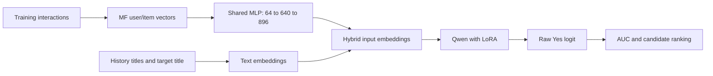

# CoLLM RecSys — Group 6

โค้ดสำหรับศึกษา **CoLLM-MF** บน MovieLens-1M เปรียบเทียบกับ MF และ TALLRec-style
text-only LoRA โดยใช้ **ROC AUC** เป็น metric หลัก

## เริ่มผ่านหน้าต่าง Train

ดับเบิลคลิก **START_TRAIN.cmd** แล้วรอการตรวจความพร้อม จากนั้นกด **Train** เพื่อ
ฝึก MF → TALLRec → CoLLM-MF → ประเมินผล → สร้างรายงาน HTML/กราฟ/CSV/ZIP
การเปิดหน้าต่างยังไม่เริ่มฝึก โค้ดต้อง commit/push แล้วก่อนเริ่มรอบจริง
แต่ละรอบมีชื่อและโฟลเดอร์แยกกัน มี log และปุ่มหยุดอย่างปลอดภัย

คู่มือสั้นสำหรับใช้งาน: [docs/TRAIN_GUIDE_TH.md](docs/TRAIN_GUIDE_TH.md)

**ยังไม่ได้เริ่มเทรนจริง** ตามคำขอของผู้ใช้ อนุญาตเฉพาะการเตรียมงาน, preflight,
unit tests และ smoke checks ขนาดเล็ก ผล smoke ใช้ตรวจ pipeline เท่านั้น ไม่ใช่ผลส่งงาน
สถานะการตรวจล่าสุดดูที่ [results/verification.json](results/verification.json)

## ตรวจความพร้อมโดยไม่เทรน

รันจาก root ของ repository ใน PowerShell:

```powershell
.\.venv\Scripts\python.exe -m collm.run --check --config configs/local.yaml
.\.venv\Scripts\python.exe -m pytest -q
```

`--check` ตรวจข้อมูล, pinned model assets, prompts, device และ output directory
โดยไม่โหลดน้ำหนัก LLM เพื่อฝึก ไม่สร้าง checkpoints และไม่ทำ optimizer updates
การเอา `--check` ออกจะเริ่ม pipeline ฝึกจริง จึงยังไม่รันคำสั่งนั้นจนกว่าผู้ใช้จะสั่ง

## วิธีการ



1. **MF:** ฝึก user/item embeddings ด้วย dot-product prediction และ BCE
2. **Stage 1:** ใช้ text-only prompt ฝึกเฉพาะ LoRA เป็น TALLRec-style baseline
3. **Stage 2:** ตรึง Qwen, LoRA และ MF แล้วฝึกเฉพาะ MLP ที่แปลง MF vectors
   ไปแทน embeddings ที่ตำแหน่ง user/item features ใน prompt
4. **Evaluation:** โหลด checkpoints ที่เลือกด้วย validation แล้วใช้ test rows
   ชุดเดียวกันกับทั้งสามโมเดล

โค้ดคำนวณ output-head **เพียงแถวของ Yes** และใช้ `BCEWithLogitsLoss` บน raw logit
ตาม Qwen implementation ต้นฉบับ ไม่มี vocabulary softmax หรือ Yes/No softmax
Stage 2 ยังต้องส่ง gradient ผ่าน LLM กลับไปหา MLP แม้น้ำหนัก LLM จะถูก freeze

## ข้อมูลและค่าที่เสนอสำหรับรอบจริง

ข้อมูลดิบดาวน์โหลดจาก GroupLens แล้วแบ่งตามเวลาเป็น train **33,891**, validation
**10,401**, test **7,331** interactions โดย rating `> 3` เป็น positive
history มี positive movies สูงสุด 10 เรื่องที่เกิดก่อนเป้าหมายอย่างเคร่งครัด
ไม่รวมเหตุการณ์ timestamp เดียวกัน

ใช้ rolling observed-feedback protocol: feedback ใน validation/test ที่เกิดก่อนหน้า
อาจอยู่ใน prompt ของเหตุการณ์ถัดไปได้ แต่ไม่ใช้ปรับน้ำหนักโมเดล
การสุ่มลด training rows ไม่ได้ลบอดีตที่สังเกตได้ออกจาก history

| รายการใน `configs/local.yaml` | ค่าที่เสนอ — ยังไม่ได้รันจริง |
|---|---|
| Backbone | Qwen2-0.5B, pinned revision ใน config |
| Train / validation / test selection | 4,096 / 512 / 1,024, seed 42 |
| MF dimension / MLP | 64 / 64 → 640 → 896, shared mapping |
| History / input length | 10 หนัง / สูงสุด 256 tokens |
| LoRA | r=8, alpha=16, dropout=0.05, q_proj/v_proj |
| Batch / accumulation | 4 / 2, effective batch 8 |
| Optimizer steps | 512 ต่อ LLM stage |
| Learning rates | MF เลือก 1e-3/1e-2; LoRA 1e-4; MLP 1e-3 |
| Time ceiling | สูงสุด 6 ชั่วโมงต่อคำสั่ง ไม่ใช่เวลาที่ต้องรันให้ครบ |

เป็นการทำซ้ำที่ปรับตามทรัพยากร: backbone, subset, prompt length, training steps
และ constant learning rates ต่างจากการทดลองหลัก ต้องระบุเมื่อรายงานผล
AUC วัดบน observed ratings ส่วน ranking CSV เป็นตัวอย่าง candidate ranking
ไม่ใช่ full-catalog top-k evaluation

## Environment และ assets

เครื่องนี้ใช้ Python 3.11 ใน `.venv` และ Intel Arc 140T ผ่าน PyTorch XPU
เครื่อง Windows ใหม่จัด environment ได้ด้วย `python scripts/setup.py --device xpu`
หรือ `--device cpu` โดยไม่เปลี่ยน PowerShell execution policy

```powershell
.\.venv\Scripts\python.exe -m collm.assets download --config configs/local.yaml
.\.venv\Scripts\python.exe -m collm.data
```

โมเดลถูก pin ด้วย `model.id` และ `model.revision` รวมทั้งตรวจ SHA256 ของ config,
tokenizer และ weights จาก `models/<name>/collm_source.json` ข้อมูลดิบมี checksum
ที่กำหนดไว้ และ selected records มี hash ครอบคลุมทั้ง inputs, history และ labels

`requirements.txt` ล็อกแพ็กเกจหลัก; `requirements-lock.txt` บันทึก environment
Windows/XPU ที่ใช้งานจริง ไฟล์ขนาดใหญ่ใน `.tools/`, `.venv/`, `.cache/`, `data/`,
`models/` และ `outputs/` ไม่รวมใน Git/source ZIP

## การรันและ checkpoints

**ทดลองใหม่ต้องใช้ `output_dir` ใหม่ภายใต้ `outputs/`** โปรแกรมปฏิเสธการเขียนทับ
stage ที่มีข้อมูลแล้ว ถ้าแยกรันทีละ stage ให้ใช้ config/run เดียวกันและทำตามลำดับ
MF → Stage 1 → Stage 2 → evaluation

- ใช้ `configs/smoke.yaml` สำหรับตรวจเล็ก ๆ: 32/16/16 records และ 2 optimizer
  steps ต่อ LLM stage ให้คัดลอก config แล้วตั้ง `output_dir` ใหม่ก่อนรันซ้ำ
- รอบจริงใช้ `configs/local.yaml` **หลังได้รับคำสั่งให้เริ่มจากผู้ใช้เท่านั้น**
- แต่ละ stage เริ่ม process และงบเวลาใหม่ เพดาน 6 ชั่วโมงไม่ได้เป็น global timer
  รวมทั้ง pipeline และตรวจเวลาเป็นช่วงระหว่าง batches
- ตัวเปิดเทรนนำขั้นที่เสร็จและผ่านการตรวจกลับมาใช้ได้ ส่วนขั้นที่ค้างเริ่มใหม่
  ไม่ใช่ optimizer-step resume; `last/` เป็น snapshot สำหรับตรวจสอบ

Selected checkpoints แต่ละเวอร์ชันอยู่ในโฟลเดอร์แยกที่ไม่เขียนทับ:

```text
outputs/<run>/
  run.json
  mf/      best.json → checkpoints/<selection>/model.pt
  stage1/  best.json → checkpoints/<selection>/adapter_model.safetensors
  stage2/  best.json → checkpoints/<selection>/mapper.pt
```

`best.json` เป็น metadata/pointer ที่อัปเดตหลัง weights ถูกบันทึกและ hash สำเร็จ
Stage 2 ผูกกับ **MF และ LoRA checkpoint ที่ใช้จริง** และตรวจซ้ำก่อน evaluation
แต่ละ stage มี `last/`, `summary.json` และ `status.json` สำหรับสถานะเมื่อจบ/หยุด
การทดลองที่ใช้ config, ข้อมูล, model assets หรือ implementation คนละชุดถูกปฏิเสธ

ผลอยู่ใน `results/<run>/`: `metrics.json`, `predictions.csv`, `ranking_example.csv`,
`ranking_context.json`, `auc_comparison.png` และ `REPORT.md`
ถ้าประเมินซ้ำ ให้เลือกโฟลเดอร์ผลใหม่ เช่น:

```powershell
# ใช้ได้หลังมี checkpoints ของรอบจริงแล้ว; ไม่ฝึกโมเดลเพิ่ม
.\.venv\Scripts\python.exe -m collm.evaluate --config configs/local.yaml --results-dir results/local_eval02
```

## อ่านโค้ดและเตรียมส่งงาน

| ไฟล์ | หน้าที่ |
|---|---|
| `collm/data.py` | temporal split, history, subsets และ content fingerprints |
| `collm/models.py` | MF, prompts, LoRA, CIE และ Yes-logit scoring |
| `collm/train.py` | ฝึกแต่ละ stage, budget, last snapshots และ short benchmark |
| `collm/checkpoints.py` | run identity, immutable selections และ parent verification |
| `collm/evaluate.py` | AUC, fixed-context ranking และรายงาน |
| `collm/run.py` | preflight และเรียก pipeline ตามลำดับ |
| `collm/launcher.py` | หน้าต่าง Train, log, ปุ่มหยุดและเปิดผลลัพธ์ |
| `collm/pipeline.py` | จัดรอบทดลอง, ป้องกันงานซ้อน, นำขั้นที่เสร็จกลับมาใช้ |
| `collm/delivery.py` | สรุปภาษาไทย, HTML, กราฟการฝึก และ source/results ZIP |
| `collm/git_state.py` | ตรวจว่า source commit ถูก push ก่อนเทรนจริง |

- [สถานะและงานที่ยังรอ](docs/STATUS_TH.md)
- [การตัดสินใจและ benchmark เดิม](docs/DECISIONS.md)
- [คู่มือทำความเข้าใจและเตรียมสอบ](docs/STUDY_GUIDE_TH.md)
- [อ้างอิงและเงื่อนไขการใช้](NOTICE.md)

สร้าง source ZIP ด้วย `.\.venv\Scripts\python.exe scripts/package_submission.py`
ไฟล์ออกที่ `submission/CoLLM_RecSys_G6TP_source.zip` โดยไม่ส่งขึ้น MyCourseVille
ชุดที่เตรียมก่อนเทรนจริงยังไม่มีผลทดลองจริงสำหรับ submission ฉบับสมบูรณ์
